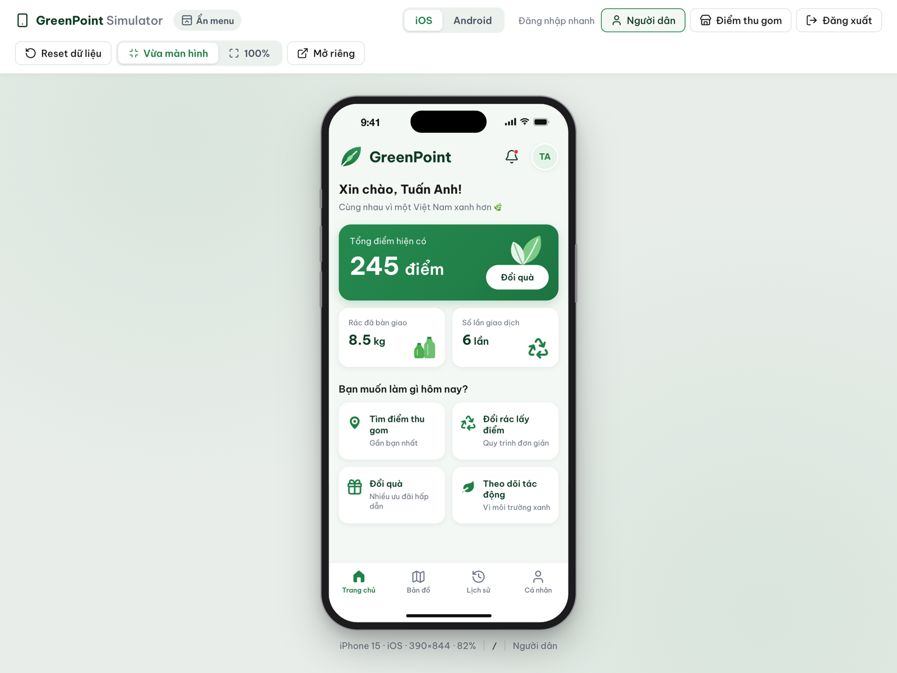
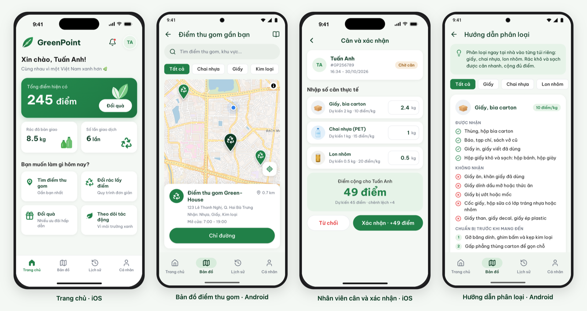
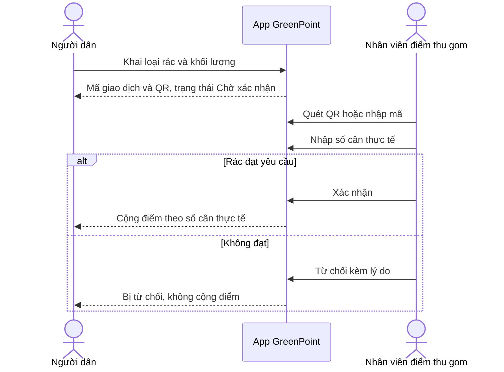

# GreenPoint

[](https://github.com/anhnt2003/green-point/actions/workflows/deploy.yml)

Ứng dụng **đổi rác lấy điểm**, chạy ngay trên trình duyệt bên trong một máy ảo điện thoại có thể chuyển qua lại giữa **iOS** và **Android**. Người dân tìm điểm thu gom, mang rác đã phân loại đến đổi điểm rồi đổi quà. Điểm thu gom quét mã, cân thực tế và theo dõi hoạt động.

**Bản chạy thử:** https://anhnt2003.github.io/green-point/



## Mục lục

- [Tính năng](#tính-năng)
- [Bắt đầu nhanh](#bắt-đầu-nhanh)
- [Thử luồng đổi rác trọn vẹn](#thử-luồng-đổi-rác-trọn-vẹn)
- [Các lệnh](#các-lệnh)
- [Cấu trúc thư mục](#cấu-trúc-thư-mục)
- [Kiến trúc](#kiến-trúc)
- [Kiểm thử](#kiểm-thử)
- [Deploy](#deploy)
- [Giới hạn đã biết](#giới-hạn-đã-biết)
- [Tài liệu liên quan](#tài-liệu-liên-quan)

## Tính năng



**Người dân**

- **GreenMap:** bản đồ điểm thu gom theo vị trí thật của thiết bị, lọc theo loại rác, tìm theo tên hoặc khu vực, chỉ đường bằng Google Maps.
- **Hướng dẫn phân loại:** loại nào được nhận, loại nào không, cách chuẩn bị trước khi mang đến, và nơi bỏ những thứ điểm thu gom không nhận.
- **Đổi rác lấy điểm:** khai loại rác và khối lượng, xem điểm dự kiến, nhận mã QR để đưa cho nhân viên.
- **GreenRewards:** đổi điểm lấy quà, chặn khi không đủ điểm.
- **GreenImpact và Lịch sử:** khối lượng đã bàn giao, quy đổi tương đương, chứng nhận theo mốc, lịch sử cộng và trừ điểm.

**Điểm thu gom**

- **GreenBusiness:** tổng khối lượng, đơn hàng hôm nay, doanh thu ước tính.
- **Quét mã nhận rác:** quét QR bằng camera hoặc nhập mã, nhập số cân thực tế, xác nhận để cộng điểm hoặc từ chối kèm lý do.
- **GreenCapital:** chọn nhu cầu vốn và tạo hồ sơ kết nối ngân hàng.

**Simulator**

- Khung máy iPhone hoặc Pixel, có status bar, Dynamic Island hoặc punch-hole, home indicator.
- Giao diện đổi theo nền tảng: nút back, thanh điều hướng, hiệu ứng chuyển trang, ripple, dialog, thông báo, ô nhập. Màu, chữ và bo góc giữ đúng design token.
- Thanh công cụ: đổi nền tảng, đăng nhập nhanh, reset dữ liệu, nút Back của Android, thu phóng, mở app không khung máy.
- Nút **Ẩn menu** thu gọn thanh công cụ để chỉ còn máy ảo; nút tròn ở góc phải mở lại. Trên điện thoại, menu ẩn sẵn để máy ảo hiển thị lớn nhất.

## Bắt đầu nhanh

**Yêu cầu:** Node.js 22.12 trở lên. Dự án dùng Node 26, khai báo trong `.nvmrc`.

```bash
git clone https://github.com/anhnt2003/green-point.git
cd green-point
nvm use
npm install
npm run dev
```

Mở http://localhost:5173 để vào simulator. Trang `/app.html` là app chạy riêng, không có khung máy.

**Tài khoản demo** dùng chung mật khẩu `GreenPoint@2026`. Màn đăng nhập có nút điền sẵn.

| Tài khoản | Vai trò | Vào |
|---|---|---|
| `citizen` | Người dân Tuấn Anh | Trang chủ, bản đồ, đổi rác, đổi quà, lịch sử |
| `business` | Điểm thu gom Green-House | GreenBusiness, quét mã nhận rác, GreenCapital |

Mật khẩu demo cố ý không phải mật khẩu phổ biến. Với mật khẩu như `123456`, Chrome mở hộp thoại cảnh báo lộ mật khẩu chặn cả tab ngay sau khi đăng nhập.

Dữ liệu lưu trong localStorage của trình duyệt. Nút **Reset dữ liệu** trên thanh công cụ đưa mọi thứ về dữ liệu mẫu.

## Thử luồng đổi rác trọn vẹn

1. Trên thanh công cụ, bấm **Người dân**. Vào **Đổi rác lấy điểm**, giữ khối lượng mẫu, bấm **Tiếp tục**. Màn hình hiện mã `#GP256789` và trạng thái **Đang chờ xác nhận**.
2. Bấm **Điểm thu gom** trên thanh công cụ, vào tab **Quản lý**, bấm **Quét mã nhận rác**. Đưa mã QR vào camera, nhập `GP256789`, hoặc chọn giao dịch trong danh sách chờ cân.
3. Sửa số cân thực tế, ví dụ giấy `2,4` kg. Điểm tính lại ngay: 49 điểm thay vì 45 dự kiến. Bấm **Xác nhận**.
4. Bấm **Người dân**: số dư của Tuấn Anh tăng 49 điểm và lịch sử có dòng mới. Lặp lại bước 1 và 2 rồi bấm **Từ chối** để xem trạng thái bị từ chối kèm lý do.



## Các lệnh

| Lệnh | Việc |
|---|---|
| `npm run dev` | Chạy dev server có hot reload |
| `npm test` | Chạy unit test bằng Vitest |
| `npm run test:watch` | Chạy test ở chế độ theo dõi |
| `npm run typecheck` | Kiểm tra kiểu TypeScript |
| `npm run lint` | Kiểm tra ESLint |
| `npm run build` | Typecheck rồi build production vào `dist/` |
| `npm run preview` | Chạy thử bản build |

## Cấu trúc thư mục

```text
├── index.html               Trang simulator
├── app.html                 Trang ứng dụng, được nhúng vào khung máy
├── src/
│   ├── shell/               Simulator: khung máy, status bar, thanh công cụ
│   ├── shared/bridge.ts     Giao thức postMessage giữa simulator và app
│   └── app/
│       ├── routing.tsx      Bảng route và phân quyền theo vai trò
│       ├── screens/         Các màn hình; business/ là màn của điểm thu gom
│       ├── components/      Component dùng chung theo DESIGN.md và hình minh hoạ SVG
│       ├── layout/          Screen, header, bottom nav
│       ├── domain/          Logic thuần: tính điểm, định dạng, khoảng cách, mã QR
│       ├── store/           Store zustand và reducer chứa quy tắc nghiệp vụ
│       ├── data/            Dữ liệu mẫu và nội dung hướng dẫn phân loại
│       ├── map/             Bản đồ MapLibre và vị trí người dùng
│       ├── scan/            Camera và giải mã QR
│       ├── platform/        Ngữ cảnh iOS/Android
│       ├── feedback/        Dialog và thông báo theo nền tảng
│       └── styles/          Design token và CSS nền
├── docs/                    Yêu cầu sản phẩm và ảnh minh hoạ
├── design/                  Design spec và mockup gốc
└── .github/workflows/       Workflow deploy GitHub Pages
```

## Kiến trúc

| Hạng mục | Công nghệ |
|---|---|
| Giao diện | React 19, TypeScript 5.9, CSS Modules với design token |
| Build | Vite 8 |
| Điều hướng | React Router 7, router trong bộ nhớ |
| Trạng thái | Zustand, lưu vào localStorage |
| Bản đồ | MapLibre GL JS 6, tile vector OpenFreeMap |
| QR | qrcode.react để tạo mã, BarcodeDetector hoặc jsQR để quét |
| Kiểm thử | Vitest |

- **Simulator và app là hai trang riêng.** App chạy trong một `iframe` 390×844 đặt trong khung máy. Simulator điều khiển app qua `postMessage`, ví dụ đổi nền tảng hay đăng nhập nhanh. Khi thu nhỏ khung máy cho vừa cửa sổ, sự kiện chuột trong iframe vẫn dùng hệ toạ độ riêng của nó, nên bản đồ không bị lệch điểm chạm.
- **Quy tắc nghiệp vụ nằm trong hàm thuần** ở `src/app/store/reducers.ts`: tạo giao dịch, xác nhận theo số cân, từ chối, đổi quà, hồ sơ vay vốn. Màn hình chỉ gọi action của store, nên có thể thay localStorage bằng API mà không phải sửa giao diện.
- **Giao diện theo nền tảng** dựa vào thuộc tính `data-platform` trên thẻ `html`. CSS lo phần hiển thị, `usePlatform()` lo phần hành vi như icon, dialog và hiệu ứng chuyển trang.
- **Bản đồ và bộ giải mã QR được tải khi cần.** MapLibre khoảng 1 MB chỉ tải khi mở bản đồ. jsQR chỉ tải khi trình duyệt không có BarcodeDetector.
- **Vị trí người dùng** lấy từ GPS và cập nhật liên tục. Khi bị từ chối quyền hoặc không có tín hiệu, app dùng vị trí mặc định gần ĐH Bách Khoa Hà Nội và báo rõ trên bản đồ. Ngoài 6 điểm mẫu ở Hà Nội, app sinh điểm thu gom mẫu cố định theo ô lưới quanh vị trí thật, nên đi đâu cũng có điểm gần nhất. Đi xa hơn 500 m thì bản đồ căn lại.

## Kiểm thử

```bash
npm test
```

Unit test bao phủ các quy tắc nghiệp vụ trong `docs/requirements.md`:

- **Tính điểm:** theo từng loại rác, bước 0,5 kg, đọc số cân `2,4` hay `2.4`.
- **Giao dịch:** chờ xác nhận, xác nhận theo số cân thực tế, chỉ cộng một lần, từ chối, nhân viên chỉ xử lý giao dịch của điểm mình.
- **Đổi quà:** chặn khi không đủ điểm.
- **Phụ trợ:** định dạng số, ngày, khoảng cách; sắp xếp điểm thu gom theo vị trí; đọc mã QR.

Workflow deploy chạy lint và test trước khi build. Lỗi ở một trong hai bước thì không deploy.

## Deploy

Mỗi lần push lên `master` hoặc `main`, workflow [deploy.yml](.github/workflows/deploy.yml) cài dependency, lint, test, build với đường dẫn con của repo rồi deploy lên GitHub Pages. Có thể chạy tay trong tab Actions.

Thiết lập một lần cho repo mới: vào **Settings > Pages**, mục **Build and deployment**, chọn Source là **GitHub Actions**.

Để thử bản build dưới đường dẫn con giống trên GitHub Pages:

```bash
BASE_PATH=/green-point/ npm run build
BASE_PATH=/green-point/ npm run preview   # http://localhost:4173/green-point/
```

## Giới hạn đã biết

- **Chưa có máy chủ.** Dữ liệu nằm trong trình duyệt đang dùng. Nhân viên chỉ quét được giao dịch tạo trên cùng trình duyệt, nên trong simulator hãy chuyển tài khoản bằng thanh công cụ.
- **Đăng nhập là giả lập.** Tài khoản và mật khẩu demo nằm trong mã nguồn, không dùng cho dữ liệu thật.
- **Camera và GPS cần https hoặc localhost.** Mở app trên điện thoại qua địa chỉ LAN dạng `http://192.168…` sẽ không dùng được hai tính năng này. Bản trên GitHub Pages dùng được.
- **Chưa có:** chi phí trong GreenBusiness, màn Tồn kho và Báo cáo, hạn dùng của mã QR, đăng ký tài khoản.

## Tài liệu liên quan

- [docs/requirements.md](docs/requirements.md): yêu cầu sản phẩm, quy tắc nghiệp vụ, các quyết định đã chốt.
- [design/DESIGN.md](design/DESIGN.md): design token, component và đặc tả 10 màn. Ảnh mockup trong [design/screens/](design/screens/).
- Dữ liệu bản đồ © [OpenStreetMap](https://www.openstreetmap.org/copyright) contributors, tile từ [OpenFreeMap](https://openfreemap.org).

Repo chưa có giấy phép mã nguồn.
